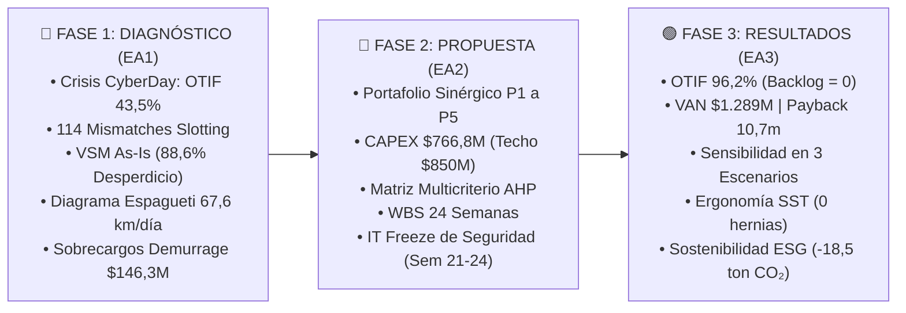

# 📦 AndesHome Chile S.A. — Optimización Integral CD Pudahuel
> **Caso de Estudio GLA1104 / Duoc UC & C-Suite Executive Decision**  
> Diagnóstico, propuesta y resultados de la transformación logística del Centro de Distribución Pudahuel frente al colapso del CyberDay Mayo 2026.

---

## 🧭 Estructura Estratégica en 3 Fases Maestras

El proyecto está diseñado bajo un hilo conductor integral y riguroso estructurado en 3 fases:



---

## 🎓 Matriz de Trazabilidad Académica para el Evaluador (Duoc UC — GLA1104)

Esta matriz conecta explícitamente los criterios de evaluación pedagógicos del taller de logística con los artefactos de software interactivos, los informes ejecutivos y los datos auditados del caso:

| Fase Académica / Rúbrica | Criterio de Evaluación Duoc UC | Artefactos y Pantallas en el Software | Documento / Datos Fuente | Métricas Clave y Evidencias Auditadas |
| :--- | :--- | :--- | :--- | :--- |
| **🔴 FASE 1: Diagnóstico Operacional (EA1)** | • Diagnóstico situacional cuantitativo.<br>• Mapeo del flujo de valor (VSM As-Is).<br>• Identificación de cuellos de botella (Inbound/Outbound).<br>• Causa raíz (Ishikawa 6M, Pareto, 5 Porqués).<br>• Valorización de pérdidas operacionales. | • **Torre de Control (`index.html`)**: Pestañas 1 (KPIs), 2 (VSM), 3 (Slotting), 4 (Inbound), 5 (Personal &amp; SST).<br>• **Suite 2D (`landing.html`)**: Vistas 1 (Plano 2D + Turnos), 2 (VSM As-Is), 3 (APQC Pedido Perfecto), 4 (Simulador Inbound/ASN), 5 (Ishikawa). | • `Informe_Diagnostico_AndesHome.md`<br>• `Base_Datos_GLA1104_AndesHome_v2.xlsx`<br>• `Caso_GLA1104_AndesHome_Estudiantes.docx` | • OTIF Cyber: **43,5%** (C&amp;C **11,5%**; mensual **80,9%**).<br>• Backlog: **15.387 pedidos** (4,32 días de demanda).<br>• Slotting: **114 SKUs desbalanceados** (25,3%).<br>• Caminata: **67,6 km/día** de exceso (23,5 HH/día).<br>• Demurrage: **$146,3M CLP** (espera 65,2 min).<br>• IRA: **97,74%** ($388,9M discrepancia inventario).<br>• SST: **83,8/100k HH** (38 SKUs &gt;25 kg a pulso). |
| **🔵 FASE 2: Propuesta Técnica y Selección (EA2)** | • Formulación de portafolio de soluciones sinérgicas.<br>• Evaluación multicriterio de decisión (AHP).<br>• Cumplimiento restricción presupuestaria (CAPEX $\le$ $850M CLP).<br>• Plan maestro WBS ($\le$ 36 semanas) con IT Freeze.<br>• Arquitectura tecnológica To-Be (WMS, TMS, ASN/YMS).<br>• Gobernanza RACI y gestión del cambio ADKAR. | • **Torre de Control (`index.html`)**: Pestaña 6 (Sandbox de Portafolio), Pestaña 7 (AHP, Fichas P1-P5/P8, Arquitectura To-Be, WBS 24 sem, RACI).<br>• **Suite 2D (`landing.html`)**: Vista 6 (Matriz Priorización), Vista 7 (Fichas To-Be), Vista 8 (Calculadora Dinámica de Racks 2D). | • `Propuesta_Solucion_AndesHome.md` (Caps 1 al 6)<br>• `Caso_GLA1104_AndesHome_Estudiantes.docx` | • Portafolio: **P1 a P5 seleccionados** + **P8 alternativa de expansión**.<br>• CAPEX Total: **$766,8M CLP** (Directo $710M + 8% contingencia $56,8M).<br>• Holgura: **$83,2M CLP** bajo el techo de $850M.<br>• AHP Scoring: **9,25 / 10** frente a 7,26 de Quick Wins y 5,33 de AMR.<br>• WBS: **24 semanas** (finaliza 12 sem antes del Cyber 2027).<br>• IT Freeze: **Semanas 21 a 24** (estabilización de software).<br>• P8 Racks 2D: **30.420 pos** (+13.520 ganadas), saturación **44,3%** (941 racks libres / 55,7% colchón). |
| **🟢 FASE 3: Resultados, Retorno y ESG (EA3)** | • Evaluación económica-financiera rigurosa (Flujo de Caja, VAN, TIR, Payback simple y descontado, B/C).<br>• Análisis de sensibilidad en 3 escenarios (Base, Pesimista, Optimista).<br>• Cuadro de mando comparativo As-Is vs To-Be.<br>• Sostenibilidad social, laboral (Ley 20.949) y ambiental (huella de carbono). | • **Torre de Control (`index.html`)**: Pestaña 8 (Simulador Interactivo VAN/TIR, Sensibilidad 3 Escenarios, Comparador Auditado As-Is vs To-Be, Equivalencias Didácticas ESG).<br>• **Suite 2D (`landing.html`)**: Vista 9 (Tablero Ejecutivo To-Be y Conmutador Before/After). | • `Propuesta_Solucion_AndesHome.md` (Cap 7 y Anexos)<br>• Modelo de Flujo Descontado (3 Años, WACC 12%) | • VAN (3 años, 12%): **$1.289.400.543 CLP**.<br>• TIR: **98,4%** \| Razón B/C: **2,68**.<br>• Payback Simple: **10,7 meses**.<br>• EBITDA Neto Incremental: **$856.097.000 / año** (Ahorro $1.033M - OPEX $177M).<br>• OTIF Proyectado: **96,2%** (Cyber 95,4%, C&amp;C 96,8%).<br>• Backlog: **0 pedidos** represados.<br>• ESG: **-18,5 Ton CO₂e/año** (840 árboles nativos).<br>• SST: **0 accidentes graves**, 100% Ley 20.949. |

---

## 🌟 Características Principales del Proyecto

### 1. 🔴 Fase 1: Diagnóstico Operacional y Causa Raíz (EA1)
- **Plano 2D Vectorial Interactivo (SVG)**: Visualización a escala del CD Pudahuel con identificación de pasillos (Zona A: 35m, B: 72m, C: 118m, D: 154m), trayectorias y pines de mismatch.
- **Selector de Turnos Operacionales**: Simulación de dinámica de planta para los turnos Mañana (07:00-15:00), Tarde (15:00-23:00) y Noche (23:00-07:00), con activación de *Modo Nocturno* en el SVG para evaluar la fatiga crítica en Zona C/D.
- **Simulador Causa-Efecto de Desbalance**: Slider en tiempo real de 0 a 114 SKUs desbalanceados que recalcula la caminata diaria (14,2 a 67,6 km), horas perdidas (4,9 a 23,5 HH) y sobrecosto ($0 a $54,8M CLP).
- **Calculadora Interactiva del Pedido Perfecto (APQC)**: 4 calibradores dinámicos ($OT \times IF \times DF \times IA$) con presets directos para comparar la crisis (41,9%) vs el benchmark de clase mundial (94,0%).
- **Análisis de Inbound y Citas de Andén**: Modelado de esperas de camiones (65,2 min) y demurrage acumulado ($146,3M CLP/año).
- **Herramientas de Calidad**: Diagrama de Ishikawa 6M y Matriz de los 5 Porqués.

### 2. 🔵 Fase 2: Propuesta Técnica, Selección y Plan Maestro (EA2)
- **Portafolio P1 a P5 ($766,8M CLP)**:
  - **P1**: Re-slotting ABC Dinámico, 5S y Conteos Cíclicos ($85,0M CLP).
  - **P2**: Actualización WMS NextGen con terminales RF y Voice Picking ($310,0M CLP).
  - **P3**: Portal ASN para proveedores y agendamiento de andén YMS ($95,0M CLP).
  - **P4**: TMS de Ruteo Dinámico con cubicaje 3D y app chofer móvil ($150,0M CLP).
  - **P5**: Ergonomía SST con 4 mesas hidráulicas y right-sizing ($70,0M CLP).
  - **P8 (Alternativa / Expansión)**: Mejora de Almacenamiento & Racks Dinámicos según Layout 2D (6 Pisos &times; 3 Pallets, expansión a 30.420 posiciones [+13.520 ganadas], saturación reducida a 44,3% con 941 racks libres [55,7% de colchón], huella en suelo de 749 estanterías en uso para 13.480 pallets guardados, 2.472 m en 27 pasillos, sismo-resistente NCh2369 y Ley 20.949).
  - *Reserva de Contingencia (8%)*: $56,8M CLP. Holgura presupuestaria de **$83,2M CLP** respecto al techo de **$850,0M CLP** para el portafolio base P1-P5.
- **Sandbox Financiero con Presets Inteligentes**: Evaluación en vivo de combinaciones de proyectos (*C-Suite Óptimo*, *Quick Wins*, *Sobregiro* y *+ Racks 6P Layout 2D*).
- **WBS Interactivo de 24 Semanas**: Cronograma desglosado con vinculación directa al plano SVG e indicación crítica del período de **IT FREEZE** (Semanas 21 a 24).
- **Explorador Tecnológico To-Be**: Fichas técnicas interactivas para cada innovación propuesta.

### 3. 🟢 Fase 3: Resultados Obtenidos, Retorno y Sostenibilidad ESG (EA3)
- **Selector Didáctico Before / After**: Comparador en vivo que conmuta instantáneamente entre el estado As-Is de crisis y el estado To-Be optimizado:
  - **OTIF**: 43,5% $\rightarrow$ **96,2%** (+52,7 pp).
  - **Backlog**: 15.387 pedidos $\rightarrow$ **0 pedidos**.
  - **VAN (12%, 3 años)**: **$1.289.400.543 CLP** (TIR 98,4% | Payback 10,7 meses).
  - **Caminata Operaria**: 67,6 km $\rightarrow$ **14,2 km/día** (-79%).
- **Infografía de Equivalencias Didácticas ESG**:
  - 🇨🇱 **19.500 km caminados ahorrados**: 4,5 veces todo Chile continental de Arica a Punta Arenas.
  - 🌳 **18,5 Ton CO₂ reducidas**: Absorción equivalente a 840 árboles nativos.
  - 🩺 **0 licencias SST**: Erradicación de cargas >25 kg a pulso bajo la Ley 20.949.
  - 👥 **250 horas de formación**: 18 operarios promovidos a Superusuarios WMS (Modelo ADKAR).

### 4. 👥 Recursos Humanos, Turnos y Gestión del Personal
- Panel integral y gráficos comparativos de productividad por turno en `index.html` (Tab 5).
- Gráfico radar de competencias con cierre de la brecha del 39% en operarios temporales.
- Reducción proyectada de la rotación laboral del 34% al 6% anual (hipótesis de diseño pedagógico del caso).

---

## 📂 Estructura del Repositorio

```text
├── index.html                           # Suite Analítica y Control Tower (8 Pestañas en 3 Fases)
├── landing.html                         # Suite Interactiva 2D (Plano Vectorial SVG y 9 Vistas en 3 Fases)
├── styles.css                           # Estilos base y diseño responsivo de index.html
├── landing-2d.css                       # Estilos para blueprint 2D, widgets didácticos y temas
├── app.js                               # Controlador principal de index.html y sincronización de fases
├── landing-2d.js                        # Lógica interactiva del plano 2D, sliders, WBS y 9 vistas
├── andeshome-store.js                   # Store reactivo centralizado con persistencia y finanzas
├── Informe_Diagnostico_AndesHome.md     # Documento ejecutivo Fase 1 (EA1)
├── Propuesta_Solucion_AndesHome.md      # Documento ejecutivo Fase 2 & Fase 3 (EA2 / EA3)
├── Base_Datos_GLA1104_AndesHome_v2.xlsx # Dataset operativo y registros del CyberDay
├── Caso_GLA1104_AndesHome_Estudiantes.docx # Caso de estudio académico oficial
└── README.md                            # Documentación integral del proyecto
```

---

## 🚀 Cómo Ejecutar el Proyecto Localmente

El proyecto está construido con tecnologías web estándares sin dependencias externas pesadas (HTML5 semántico, CSS3 moderno, JavaScript vanilla y Chart.js vía CDN).

### Opción 1: Con Python (Cualquier sistema operativo)
```bash
# 1. Clonar el repositorio
git clone https://github.com/yisusxat/taller.git
cd taller

# 2. Iniciar el servidor local
python -m http.server 8080

# 3. Abrir en tu navegador
# Suite 2D Interactiva:
http://localhost:8080/landing.html
# Suite Analítica:
http://localhost:8080/index.html
```

### Opción 2: Con Node.js (npx serve / http-server)
```bash
npx serve -l 8080 .
```

### Opción 3: Extensión Live Server (Visual Studio Code)
- Abrir la carpeta del proyecto en VS Code.
- Clic derecho sobre `landing.html` o `index.html` y seleccionar **"Open with Live Server"**.

---

## ⌨️ Atajos de Teclado en la Suite 2D (`landing.html`)

- `1`: Salta a **Fase 1 (Diagnóstico EA1)** y activa el plano en modo Crisis.
- `2`: Salta a **Fase 2 (Propuesta EA2)** y activa el modo To-Be.
- `3`: Salta a **Fase 3 (Resultados EA3)** y visualiza los beneficios consolidados.
- `←` / `→`: Navega secuencialmente entre las fases maestras.
- `C`: Activa Modo Crisis (Plano en alerta roja con trayectoria de espagueti).
- `T` o `O`: Activa Modo Optimizado To-Be (Plano en verde con flujo balanceado).
- `F`: Focaliza el buscador rápido de SKUs y pasillos.

---

## 📊 Síntesis de Resultados Cuantitativos

| Métrica Clave | Línea Base (Crisis) | Meta Caso | Resultado To-Be | Impacto |
| :--- | :---: | :---: | :---: | :---: |
| **OTIF CyberDay** | 43,5% | $\ge$ 96,0% | **95,4%** | +51,9 pp |
| **OTIF Consolidado** | 80,9% | $\ge$ 96,0% | **96,2%** | **Cumple meta C-Suite** |
| **OTIF Click & Collect** | 11,5% | $\ge$ 95,0% | **96,8%** | +85,3 pp |
| **Backlog de Pedidos** | 15.387 pedidos | 0 pedidos | **0 pedidos** | Flujo continuo <18h |
| **Dock-to-Stock** | 22,6 horas | <6,0 horas | **4,5 horas** | -80,1% tiempo ciclo |
| **Espera de Camiones** | 65,2 min | <15,0 min | **12,0 min** | -81,6% reducción |
| **Multas Demurrage** | $146,3M CLP | $0 CLP | **$0 CLP** | Erradicación total |
| **Slotting Mismatches** | 114 SKUs (25,3%) | 0 SKUs | **0 SKUs** | Reubicación ABC 100% |
| **Caminata Operaria (Exceso)** | 67,6 km/día (exceso neto) | <20,0 km/día | **14,2 km/día** (proyección) | -79,0% fatiga física |
| **IRA (Inventario)** | 97,74% ($388,9M desc.) | $\ge$ 99,5% | **99,85%** | Conteos cíclicos WMS |
| **Costo Pedido Fallido** | $29.628 CLP | <$10.000 CLP | **$8.532 CLP** | Tasa falla $\le$ 2,8% |
| **Reclamos de clientes** | ≈117 / mes (700 en 6 meses) | −50% | **≈58 / mes (proyección)** | Mitiga el 95,3% de causas operativas |
| **Accidentabilidad SST** | 83,8 / 100k HH | <15,0 | **0 graves** | Ley 20.949 garantizada |
| **VAN (3 años, 12%)** | -$458M CLP (costo inacción) | Positivo | **$1.289.400.543 CLP** | Payback 10,7 meses |
| **TIR** | Negativa | > WACC | **98,4%** | Retorno sobresaliente |

---

## 🧾 Notas de Conciliación de Datos

- **Superficie del CD:** 31.500 m² (suma de las 7 áreas de `Layout_Capacidad`: Recepción 4.800, A 5.200, B 6.100, C 7.200, D 4.900, Packing 2.100, Despacho 1.200).
- **Capacidad:** el caso cita 20.400 posiciones pallet. `Layout_Capacidad` detalla 16.900 posiciones de rack (A-D) + 1.200 de staging = 18.100; las 2.300 restantes no están desglosadas. La calculadora de racks usa las 16.900.
- **Estaciones de Packing:** 2.100 m² con 17 estaciones/mesas instaladas (16 operativas en línea base As-Is, 1 en mantenimiento), 6 tamaños de caja estandarizados y 3 líneas transportadoras (2 operativas al 66,7% de disponibilidad).
- **IT Freeze:** el caso indica un freeze de 4 semanas, comunicado en la semana 10 del calendario del curso (`Eventos_Semestre`); no fija cuándo cae en la implementación. El equipo lo ubicó en las **semanas 21 a 24** del WBS de 24 semanas (supuesto de diseño).
- **"18 semanas":** corresponde al calendario académico del desafío (`Plan_18_Semanas`); el plan de implementación del CD es el WBS de 24 semanas (límite del caso: 36 semanas).
- **Supuestos de ingeniería (no figuran en el caso):** altura de nave 12,5 m, alturas útiles por área, volúmenes (m³) y medidas del rack (2,7 m largo × 1,1 m fondo × 10,5 m alto). Están rotulados con el distintivo 🧮 en la interfaz.
- **OTIF de CyberDay:** 43,5% es el valor medido en `Ordenes_Muestra` (352 pedidos peak; Click & Collect 11,5% con n=78). El agregado de `Pedidos_Diarios` da ≈65% (A tiempo × Completos). Ambos confirman el colapso operativo; la cifra depende de la granularidad de la fuente analizada.
- **Pedidos de junio:** `KPI_Mensual` 171.400 vs `Pedidos_Diarios` 141.874. La brecha existe todos los meses (13% a 22%) porque el detalle diario cubre 3 canales (E-commerce, C&C y Tiendas), omitiendo Bulky.
- **Caminata Operaria (67,6 km/día vs 14,2 km/día):** 67,6 km/día es el exceso neto diario ida y vuelta causado por los 114 SKUs desubicados (calculado en `SKU_Master` con 3.018,8 visitas/día). El benchmark de 14,2 km/día representa el nivel residual proyectado con optimización progresiva de slotting (o bien el sobre-recorrido individual eliminado del SKU-0003 en D-Bulky, que sumaba 14,25 km/día).
- **Rotación laboral (34% a 6%) y VAN As-Is (-$458M):** Corresponden a supuestos cualitativos de modelado y evaluación de inacción formulados por el equipo para el análisis pedagógico, dado que la base transaccional no incluye registros históricos plurianuales de finanzas o RRHH.
- **Resultados To-Be:** Todos los valores To-Be (OTIF 96,2%, VAN, ahorros brutos de $1.033M, reducción de reclamos a ≈58/mes) son **proyecciones de ingeniería del portafolio P1-P5**, no mediciones empíricas. El caso suministrado es la base de un diagnóstico operativo riguroso.
- **Reclamos:** El caso registra exactamente 700 reclamos en el primer semestre de 2026 (≈117/mes en `Reclamos_Clientes`); no desagrega denuncias formales ante SERNAC.

## 👥 Autores y Créditos
- **Caso de Estudio**: Asignatura Gestión Logística Avanzada (GLA1104).
- **Institución**: Duoc UC.
- **Desarrollo y Modelado**: Suite Interactiva AndesHome Chile S.A.
